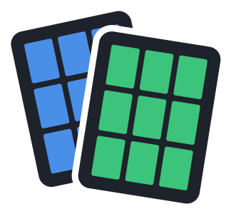
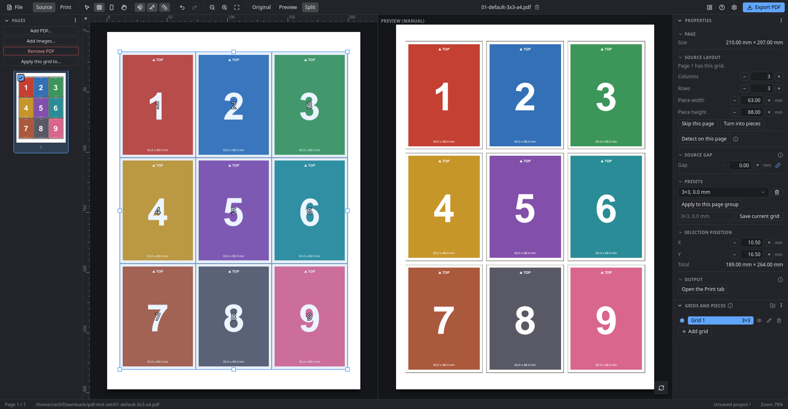
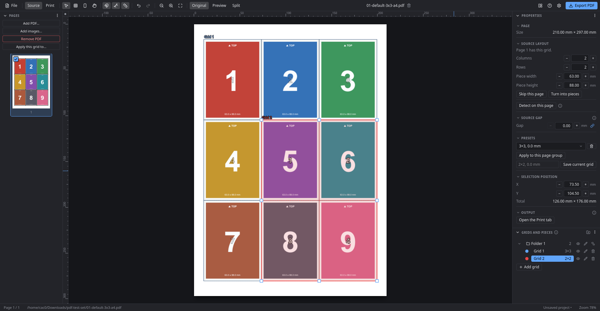
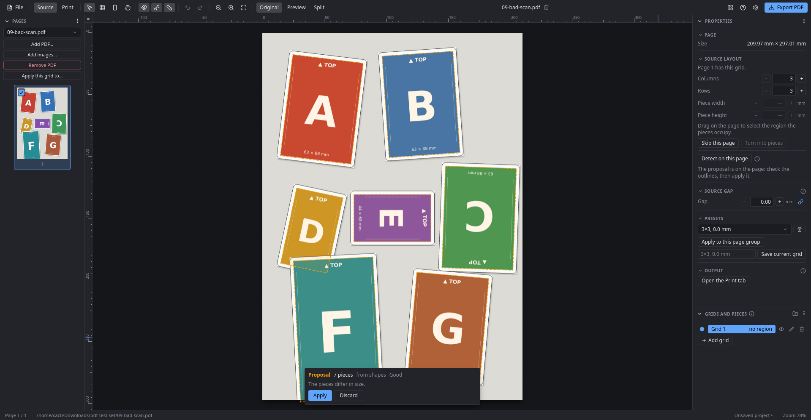
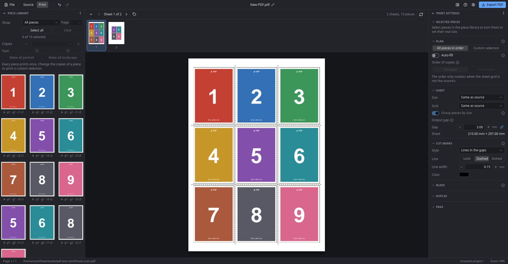
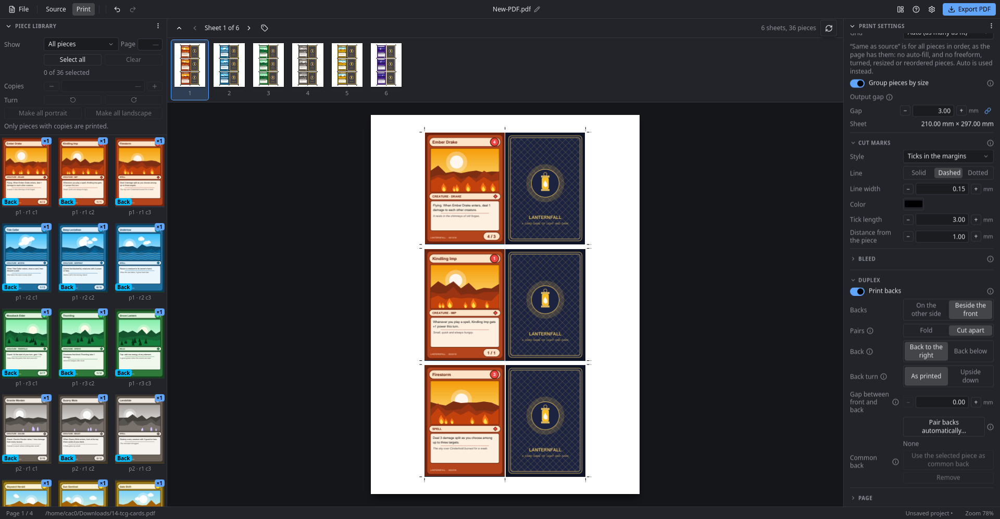
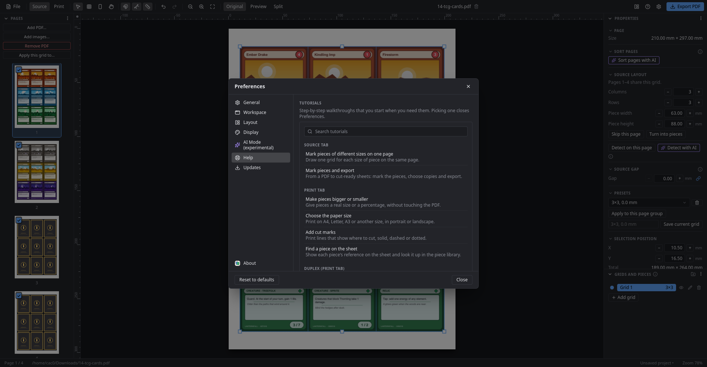
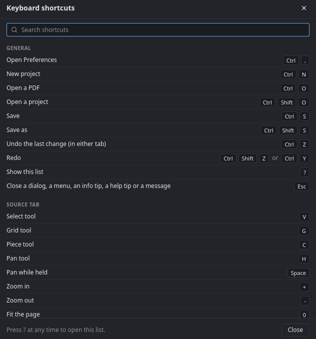

<picture>
  <source media="(prefers-color-scheme: dark)" srcset="assets/brand/logo-dark.svg">
  
</picture>

# Gutterberg

Gutterberg turns print-and-play PDFs and card scans into cut-ready sheets: exact card sizes, clean gutters, and the original artwork untouched.

[](https://github.com/JoaquinArruiz/Gutterberg/actions/workflows/ci.yml)
[](https://github.com/JoaquinArruiz/Gutterberg/releases/latest)
[](https://github.com/JoaquinArruiz/Gutterberg/releases)
[](https://github.com/JoaquinArruiz/Gutterberg/stargazers)
[](https://discord.gg/ytBFE9TtRY)

[](LICENSE)




| Several grids on one page | Detect pieces |
| --- | --- |
|  |  |

| Print tab with cut marks | Gutterfold |
| --- | --- |
|  |  |

| Tutorials | Keyboard shortcuts |
| --- | --- |
|  |  |

## Download

Get the latest version from the **[Releases page](https://github.com/JoaquinArruiz/Gutterberg/releases/latest)**
and pick the file for your system:

| System | File |
| --- | --- |
| Windows | `Gutterberg_<version>_x64-setup.exe` (or the `.msi`) |
| macOS, Apple silicon (M1 and later) | `Gutterberg_<version>_aarch64.dmg` |
| macOS, Intel | `Gutterberg_<version>_x64.dmg` |
| Linux | `Gutterberg_<version>_amd64.AppImage` (make it executable, then run it), the `.deb` or the `.rpm` |

On Windows you can also get it from the [Microsoft Store](https://apps.microsoft.com/detail/9NLQ61KCDSKZ), which
installs it without the SmartScreen warning and keeps it up to date. It is the same app. Install one or the other, not
both.

### Requirements

| System | What it needs |
| --- | --- |
| Windows | Windows 10 or 11, 64-bit, with the Microsoft WebView2 runtime (Windows 11 and up-to-date Windows 10 already have it; the installer downloads it if it is missing) |
| macOS | macOS 13 (Ventura) or later, on Apple silicon or Intel |
| Linux | A 64-bit distribution with glibc 2.35 or newer (Ubuntu 22.04, Debian 12 or Fedora 36 and later, for example). The `.deb` and `.rpm` bring in the web view they need; the AppImage carries its own |

Nothing else needs installing: the PDF engine comes with the app. Gutterberg works offline; the only things that
use the network are the check for new versions and, if you turn it on, AI Mode.

Gutterberg checks for new versions by itself (Preferences › Updates) and installs them when you say so. On Linux
the update replaces the AppImage; if you installed the `.deb` or `.rpm`, update by downloading the new one.

### The first time you open it

The builds are not signed with an Apple or Windows certificate, so your system warns you the first time. The
app is the same one you can build from this repository.

- **macOS:** right-click the app and choose **Open**, then confirm; or open **System Settings › Privacy &
  Security** and press **Open Anyway** after the first attempt.
- **Windows:** when SmartScreen says it protected your PC, press **More info**, then **Run anyway**.

### Linux: the window does not open (Wayland)

On some Linux desktops with Wayland (often with an NVIDIA graphics card) Gutterberg closes straight away, and a
terminal shows `Gdk-Message: Error 71 (Protocol error) dispatching to Wayland display`. It comes from the system's
web view (WebKitGTK), not from Gutterberg. Start it with this setting:

```sh
WEBKIT_DISABLE_DMABUF_RENDERER=1 gutterberg                              # .deb or .rpm
WEBKIT_DISABLE_DMABUF_RENDERER=1 ./Gutterberg_<version>_amd64.AppImage   # AppImage
```

To keep it for the menu entry, copy the launcher to your own folder and add the setting to its `Exec` line:

```sh
cp /usr/share/applications/Gutterberg.desktop ~/.local/share/applications/
sed -i 's|^Exec=|Exec=env WEBKIT_DISABLE_DMABUF_RENDERER=1 |' ~/.local/share/applications/Gutterberg.desktop
```

### The app closes or does not start

Gutterberg keeps a short log of what it did at start and of any error it hit. If the app closes by itself, does not
open, or shows an error, the log is the best thing to send with your report. It is a plain text file named
`gutterberg.log` (and `gutterberg.old.log`, an older copy, if there is one), in this folder:

| System | Folder | How to open it |
| --- | --- | --- |
| macOS | `~/Library/Logs/Gutterberg` | In Finder, press **Shift+Cmd+G** (Go to Folder), paste the folder and press Return |
| Windows | `%LOCALAPPDATA%\Gutterberg\logs` | Press **Win+R**, paste the folder and press Enter |
| Linux | `~/.local/share/Gutterberg/logs` | Run `xdg-open ~/.local/share/Gutterberg/logs`, or show hidden files in your file manager |

If the app does open, **Preferences › About › Copy log** copies the end of the log for you. The log is added to each
time the app starts, so the run that closed by itself is still in it when you open the app again; the end of the
file is the part that matters. It stays small by itself (about half a megabyte at most, with one older copy kept),
and you can delete the folder whenever you like. It has no PDFs, but an error can mention a file or folder name, so
look it over before you send it.

Versions up to 0.10.0 do not keep a log. On a Mac, send what Terminal prints when you run
`/Applications/Gutterberg.app/Contents/MacOS/gutterberg`, and any file starting with "Gutterberg" in
`~/Library/Logs/DiagnosticReports`.

### Reporting a problem on GitHub

You need a free [GitHub account](https://github.com/signup). Then:

1. Open the [issues page](https://github.com/JoaquinArruiz/Gutterberg/issues/new/choose) and press **Get started**
   next to **Bug report**. (In the app, **Preferences › About › Report on GitHub** opens the same form with your
   version and system already filled in.)
2. Fill in the form: the version (**Preferences › About**, which also has **Copy app info**), your
   system, what happened, the steps to make it happen again and what you expected. A PDF that does not work is the
   best test case, if you are allowed to share it. If you cannot share yours, say whether
   [`examples/09-bad-scan.pdf`](examples/09-bad-scan.pdf) (a crooked, mixed-size scan) does the same, which is
   easy to reproduce, especially for **Detect pieces**.
3. Paste the log into the **Log** box (the last 100 lines or so are enough). It is optional, but it helps a lot when
   the app closes by itself or does not start.
4. Press **Submit new issue**. Before you do, a quick look at the
   [open issues](https://github.com/JoaquinArruiz/Gutterberg/issues) tells you whether someone has already reported it.

For an idea instead of a bug, pick **Feature request** on the same page.

## Features

**Source tab: say where the pieces are**

- Draw the region of the pieces on a PDF page with the Grid tool and set its rows and columns, or draw each piece
  on its own with the Piece tool (movable, resizable and rotatable). Sizes are exact, in mm, cm or inches.
- Several grids on one page, for pages with pieces of different sizes. The Grids and pieces panel lists them with
  their names and colors, groups them in folders that move as one, hides them, and sets the order the pieces come
  out in.
- The Select tool picks, moves and resizes any grid or piece on the page, and right-click menus on the page and in
  the list rename, hide, reorder and delete them.
- **Detect pieces** proposes the grid or the rectangles of a page from the PDF's own objects, from repeating
  edges, or from the shapes in a scan, and several grids at once when a page has blocks of pieces of different
  sizes. It is a draft until you apply it.
- Snapping to the page and the other pieces, sticky edges that hold a side on the borders and cut lines of the
  artwork, rulers with guides in your unit, and number fields that work out sums like `63+3`.
- Source gap, output gap, margins and page size; **Original**, **Preview** and **Split** views; skip pages, or
  remove the ones you do not need from view; give page ranges their own grids; save grids as presets.
- A pre-flight check lists the pages that cannot be exported before anything is written.

**Print tab: choose what goes on the sheets**

- A piece library with copies per piece, from several PDFs at once; plan the sheets or fill them automatically.
- Turn pieces, sort them by dragging, and set a real size (for example 63 × 88 mm) or a percentage per piece,
  always a visible, explicit choice. Overflow is reported, never fixed by shrinking.
- Cut marks (ticks in the margins or lines in the gaps, solid, dashed or dotted), bleed, and backs: double-sided (duplex) or beside each front to fold (gutterfold), with a common back,
  a back per piece, or every back paired automatically from where it is in the file.
- Converts both ways: a gutterfold file prints double-sided, and a double-sided file prints as gutterfold.
- Export keeps the original vector content: pieces are placed and clipped, never turned into pictures.

**Images and scans**

- Add PNG, JPEG or WebP images as pieces, with the size set once for all of them. Images are never resampled,
  and a JPEG goes into the PDF byte for byte. Soft or blurry images are flagged before you export.

**Projects**

- `.gtr` project files keep everything but the PDFs, which they find again by content even if they moved.
  Double-clicking a project opens it in Gutterberg. Undo and redo cover the whole project.
- PDFs locked by their publisher against printing or changes are not exported; other restrictions are kept.

**AI Mode (optional)**

- Experimental, and off and hidden until you turn it on. Detect pieces (several grids on a page too), Sort pages and
  pair backs by picture with an AI engine of your choice (Anthropic, OpenAI-compatible, Gemini or Ollama), with your
  own key kept in the system keychain. Every action shows what is sent and to which server and asks first (until
  you say not to ask again for that server), and every result is a proposal you can edit.

**Languages and help**

- English and Spanish, a welcome tour, help tips, a keyboard shortcuts sheet and a bug report form that
  fills in your version and system.
- Twelve tutorials, from the `?` Help menu, walk you through a task on the real controls: marking pieces and
  exporting, lining up fronts and backs, gutterfold, cut marks, images as pieces and more.
- The full list of controls is in [docs/controls.md](docs/controls.md).

## Command line

Gutterberg comes with `gutterberg-cli`, which exports a saved project without opening the app. When a publisher
updates a print-and-play PDF and the pieces are in the same places, replace the file and run one command:

```sh
gutterberg-cli export my-game.gtr -o my-game-sheets.pdf
gutterberg-cli check my-game.gtr        # says what an export would refuse, writes nothing
```

The PDF is the same one the app's Export writes. If a PDF of the project is not the file it was saved with, the
command stops and says which one; add `--force` to export anyway. Settings (sheet size, gaps, copies) are the ones in
the project: change them in the app.

It is installed next to the app: in `Gutterberg.app/Contents/MacOS/` on macOS, in the install folder on Windows,
and in `/usr/bin` with the `.deb` and `.rpm` packages (the AppImage keeps it inside). Each release also has it on its
own (`gutterberg-cli-<platform>`), for a machine without the app. It needs nothing else, not even a screen.

## Privacy

The full policy is in [PRIVACY.md](PRIVACY.md). Gutterberg works on your computer. Your PDFs, images and projects
stay there, and the app has no account, no analytics and no tracking. Only two things use the network:

- **The update check**, at most once a day, asks GitHub for a small file, `latest.json`, that names the newest
  version, and downloads the new version when you say so. It sends nothing about you or your files; GitHub sees the
  request as it sees any visit to a web page. With Preferences › Updates › Tell me about set to Never, the app does
  not check by itself; the Microsoft Store copy never does, since the Store updates it.
- **AI Mode**, only if you turn it on, sends what an action needs to the provider you chose, with your own key:
  a picture of the page for Detect, small pictures of the pages for Sort pages, small pictures of the pieces for Pair
  backs. Each action shows what it sends and to which server, and waits for Send, until you tick "Don't ask again"
  for that server (Preferences › AI Mode › Ask before sending brings the question back). Your key is kept in the
  system keychain. With Ollama running on your own computer, nothing leaves it.
  - While AI Mode is on, choosing a provider in Preferences › AI Mode asks the provider for its list of models, to
    fill the Model field. That request goes to the same server as the actions, with your key when one is saved
    (Anthropic and Gemini are only asked once a key is saved), and carries nothing else: no page, picture or project.
    The list is saved on your computer and used for a week; the provider is asked again only after that, or when you
    press the reload button next to the field. Apart from this, nothing is sent in the background.

## Why

> Most print-and-play PDFs pack their cards edge to edge to save paper. That makes them hard to cut: every cut is shared by two cards, a millimetre off spoils both, and there’s nowhere for bleed or cut marks. Gutterberg takes that PDF and gives every piece its own space, at its exact size, with the original artwork untouched. I made it after none of the print shops in my area would take my board game's cards for printing, and I’m sharing it for anyone who’s had the same fight with a craft knife.

### Why not just use…

- **A general PDF editor?** It can crop and arrange pages, but re-spacing pieces that are packed edge to edge is
  slow work by hand, piece by piece.
- **Print-shop imposition software?** It is made for arranging whole pages on press sheets, not for cutting
  pieces out of a page, and it is usually paid and complex.
- **An online print-and-play or proxy maker?** Most take images, turn everything into pictures (losing the
  PDF's sharp vector content) and need your files uploaded.
- **A command-line tool or script?** It can do parts of this, but most rasterise too, and they are not for
  everyone.

## Examples

Seventeen small PDFs and a folder of images to try it on, from a plain 3 × 3 sheet to a rotated page, a scan, a
locked file, fronts and backs in separate PDFs, a page with pieces of three sizes, and a made-up card game with round
tokens and hex tiles, with what each shows and what to expect:
[examples/README.md](examples/README.md).

## Build from source

You need Node 20 or later, [pnpm](https://pnpm.io/), Rust, and on Linux the Tauri dependencies
(`webkit2gtk-4.1`, `gtk3`; see the [Tauri prerequisites](https://v2.tauri.app/start/prerequisites/)).

```sh
git clone https://github.com/JoaquinArruiz/Gutterberg.git
cd Gutterberg
pnpm install
pnpm tauri dev                 # runs the app; the first time it also fetches pdfium (see CONTRIBUTING.md)
```

The checks, as CI runs them:

```sh
pnpm lint
pnpm typecheck
pnpm test
cargo fmt --check
cargo clippy --workspace -- -D warnings
cargo test --workspace         # the render tests need pdfium: PDFIUM_LIB_PATH=<dir containing libpdfium>
```

How a release is made is in [docs/releasing.md](docs/releasing.md).

## Roadmap

Next are signed builds for macOS and Windows, so the system no longer warns you the first time. What comes after is
shaped by what people ask for: tell me on Discord or in a
[feature request](https://github.com/JoaquinArruiz/Gutterberg/issues/new?template=feature_request.yml).

## Community

Questions, a PDF that will not cooperate, a layout you are proud of: join the
**[Gutterberg Discord](https://discord.gg/ytBFE9TtRY)**. The app has the same link in Preferences › About.

## Contributing

Contributions are welcome: see [CONTRIBUTING.md](CONTRIBUTING.md). Found a bug? Use the
[issue form](https://github.com/JoaquinArruiz/Gutterberg/issues/new/choose), or Preferences › About › Report on
GitHub in the app, which fills in your version and system.

## Credits

Gutterberg is built on open-source work, with thanks to [Tauri](https://tauri.app/), Google's
[PDFium](https://pdfium.googlesource.com/pdfium/) (through [pdfium-render](https://github.com/ajrcarey/pdfium-render)
and the builds of [pdfium-binaries](https://github.com/bblanchon/pdfium-binaries)),
[lopdf](https://github.com/J-F-Liu/lopdf), [React](https://react.dev/), [Zustand](https://github.com/pmndrs/zustand) and
[React Joyride](https://github.com/gilbarbara/react-joyride). The licenses of everything the app ships with are in
Preferences › About › Third-party licenses and next to each installer.

## License

[PolyForm Noncommercial 1.0.0](LICENSE). Free for personal and noncommercial use. For any commercial use, or if
you're not sure whether your use counts, contact me: joaquinarruiz@gmail.com. The software comes as is, without
warranty.
